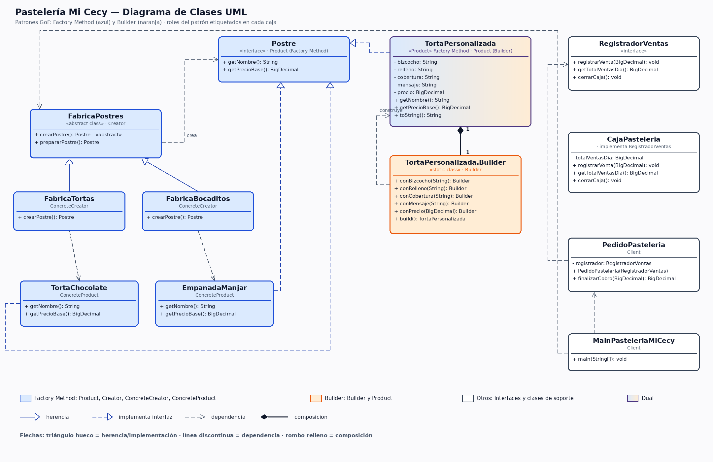
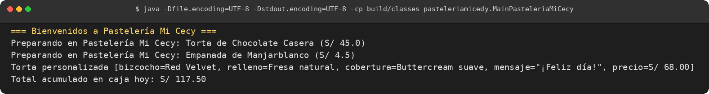
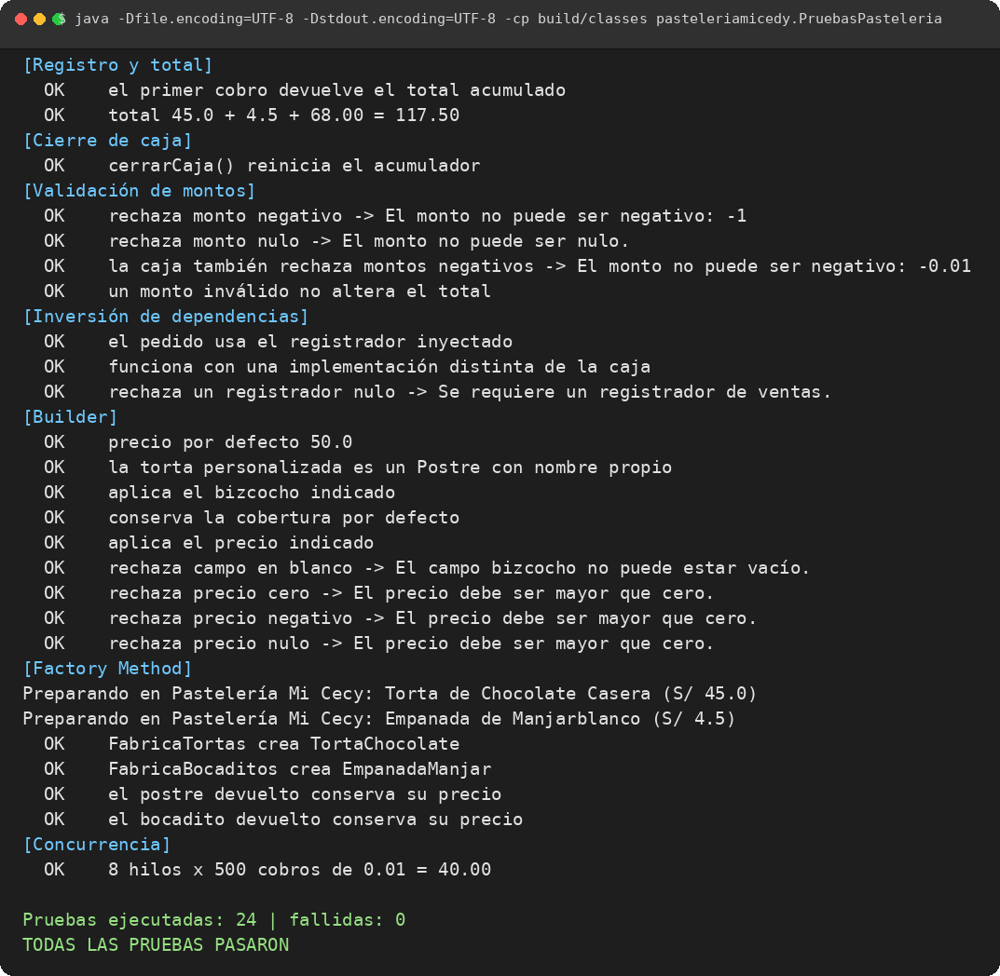

# Pastelería Mi Cecy

Proyecto Final del curso **Diseño de Patrones** (100000SI47) — Ciclo 2, Agosto 2026.
**Grupo 1** · Ingeniería de Sistemas e Informática / Ingeniería de Software.

## Integrantes

| N.º | Nombre | Código | Usuario de GitHub |
| --- | --- | --- | --- |
| 1 | <nombre por completar> | <código> | <usuario> |
| 2 | <nombre por completar> | <código> | <usuario> |
| 3 | <nombre por completar> | <código> | <usuario> |

> Todos los integrantes son colaboradores del repositorio y commitean con su propia cuenta.

## Descripción del problema

La pastelería **Mi Cecy** atiende dos líneas de producto: tortas y bocaditos (empanadas de
manjarblanco). El sistema debe:

1. **Crear productos** de distintas líneas y seguir vendiendo cualquiera de ellos en el
   mismo proceso de cobro, sin que ese proceso conozca las clases concretas.
2. **Tomar encargos de tortas personalizadas**, donde el cliente elige bizcocho, relleno,
   cobertura, mensaje y precio, pero varios de esos datos son opcionales.
3. **Registrar los cobros** en caja y conocer el total recaudado del día.

Sin patrones, el código tiende a dos problemas concretos: `Main` termina instanciando
clases concretas y decidiendo el tipo con `if`/`switch`, y la torta personalizada obliga a
un constructor con cinco parámetros donde la mayoría son opuestos a lo que el cliente pidió.

## Patrones aplicados

Se aplican **dos** patrones GoF de tipo creacional, ambos declarados y visibles en el código.

### 1. Factory Method (creacional)

- **Problema que resuelve:** crear objetos de distintas líneas de producto sin que el código
  que los usa dependa de las clases concretas.
- **Solución aplicada:** `FabricaPostres` (Creator) declara el método abstracto
  `crearPostre()`; `FabricaTortas` y `FabricaBocaditos` (Concrete Creator) deciden qué
  `Postre` instanciar. El cliente recibe siempre la interfaz `Postre`.
- **Clases participantes:**

| Rol del patrón | Clase del proyecto |
| --- | --- |
| Product | `Postre` |
| ConcreteProduct | `TortaChocolate`, `EmpanadaManjar`, `TortaPersonalizada` |
| Creator | `FabricaPostres` |
| ConcreteCreator | `FabricaTortas`, `FabricaBocaditos` |
| Client | `MainPasteleriaMiCecy` |

- **Consecuencias.**
  - *Ventajas:* `Main` no conoce las clases concretas de los postres; para agregar una línea
    nueva basta crear un `Postre` y una fábrica que lo devuelva; el cobro (`PedidoPasteleria`)
    trabaja con la abstracción. Cumple el principio Abierto/Cerrado en el eje de productos.
  - *Desventajas:* cada fábrica concreta está fijada a un solo producto, así que ofrecer
    variantes de una misma línea implica nuevas subclases; el cliente sigue eligiendo la
    fábrica concreta en `Main`.

### 2. Builder (creacional)

- **Problema que resuelve:** construir un objeto con cinco atributos, varios opcionales, que
  además debe quedar inmutable.
- **Solución aplicada:** `TortaPersonalizada.Builder` acumula los valores, conserva valores
  predeterminados para lo no indicado, valida cada entrada y devuelve la torta inmutable en
  `build()`. Cada método devuelve el propio builder, por lo que la configuración es fluida.
- **Clases participantes:**

| Rol del patrón | Clase del proyecto |
| --- | --- |
| Builder | `TortaPersonalizada.Builder` |
| Product | `TortaPersonalizada` |
| Client | `MainPasteleriaMiCecy` |

  En este proyecto no existe `Director`: el propio `Main` define la receta del encargo.

- **Consecuencias.**
  - *Ventajas:* una torta puede pedirse solo con el precio y el resto queda con valores
    razonables; no hay constructor telescópico; el objeto resultante es inmutable
    (campos `final`, constructor privado); la validación ocurre mientras se arman los datos.
  - *Desventajas:* agrega una clase interna por producto construible; al permitir todos los
    valores por defecto, un encargo puede quedar "sin personalizar".

## Principios SOLID

- **S — Responsabilidad única:** `CajaPasteleria` administra el total de ventas,
  `PedidoPasteleria` procesa el cobro, las fábricas crean los productos y el `Builder`
  arma la torta.
- **O — Abierto/cerrado:** un producto nuevo se añade implementando `Postre` y una fábrica
  nueva extendiendo `FabricaPostres`, sin modificar `PedidoPasteleria` ni `CajaPasteleria`.
- **L — Sustitución de Liskov:** `TortaChocolate`, `EmpanadaManjar` y `TortaPersonalizada`
  se usan indistintamente donde se espera un `Postre`.
- **I — Segregación de interfaces:** `Postre` (dos métodos) y `RegistradorVentas`
  (tres métodos) son contratos mínimos.
- **D — Inversión de dependencias:** `PedidoPasteleria` recibe un `RegistradorVentas` por
  constructor; la consulta del total y el cierre de caja también viven en esa abstracción.

## Diagrama de clases



Las clases azules participan del **Factory Method**; las naranjas, del **Builder**.

## Comparación antes / después

**Sin Factory Method**, el tipo de postre se resolvía con condicionales y clases concretas:

```java
// BEFORE
Postre postre;
if (tipo.equals("torta")) {
    postre = new TortaChocolate();
} else if (tipo.equals("bocadito")) {
    postre = new EmpanadaManjar();
}
```

**Con Factory Method**, la decisión de creación queda en la fábrica y el cliente solo pide
un `Postre`:

```java
// AFTER
FabricaPostres fabrica = new FabricaTortas();   // la subclase decide el producto
Postre postre = fabricar(fabrica);
```

**Sin Builder**, la torta personalizada exigía un constructor con todos los parámetros:

```java
// BEFORE
TortaPersonalizada torta = new TortaPersonalizada(
        "Red Velvet", "Fresa natural", "Buttercream suave", "¡Feliz día!", 68.0);
```

**Con Builder**, se indica solo lo que el cliente pidió y el resto queda con valores por
defecto, validando cada dato:

```java
// AFTER
TortaPersonalizada torta = new TortaPersonalizada.Builder()
        .conBizcocho("Red Velvet")
        .conRelleno("Fresa natural")
        .conPrecio(new BigDecimal("68.00"))
        .build();
```

## Ejecución

Requiere JDK 11 o superior (probado con JDK 21).

En NetBeans: abrir el proyecto y ejecutar `pasteleriamicedy.MainPasteleriaMiCecy`.

Por terminal:

```bash
mkdir -p build/classes
javac -encoding UTF-8 -d build/classes $(find src -name '*.java')
java -cp build/classes pasteleriamicedy.MainPasteleriaMiCecy
```

Salida:

```
=== Bienvenidos a Pastelería Mi Cecy ===
Preparando en Pastelería Mi Cecy: Torta de Chocolate Casera (S/ 45.0)
Preparando en Pastelería Mi Cecy: Empanada de Manjarblanco (S/ 4.5)
Torta personalizada [bizcocho=Red Velvet, relleno=Fresa natural, cobertura=Buttercream suave, mensaje="¡Feliz día!", precio=S/ 68.00]
Total acumulado en caja hoy: S/ 117.50
```

## Pruebas

Batería de verificación sin dependencias externas (24 casos: registro, cierre de caja,
validaciones, inyección de dependencias, builder, fábricas y 8 hilos registrando a la vez):

```bash
javac -encoding UTF-8 -d build/classes $(find src test -name '*.java')
java -cp build/classes pasteleriamicedy.PruebasPasteleria
```

Termina con `TODAS LAS PRUEBAS PASARON` y código de salida 0.

## Capturas de pantalla





## Estructura del repositorio

```
DP-2026-Grupo1-PasteleriaMiCecy/
├── README.md
├── docs/
│   ├── diagrama-clases.png
│   ├── presentacion.pdf
│   └── capturas/
│       ├── salida_programa.png
│       └── salida_pruebas.png
├── src/pasteleriamicedy/
│   ├── MainPasteleriaMiCecy.java
│   ├── Postre.java
│   ├── TortaChocolate.java
│   ├── EmpanadaManjar.java
│   ├── TortaPersonalizada.java      # Builder
│   ├── FabricaPostres.java          # Creator
│   ├── FabricaTortas.java           # ConcreteCreator
│   ├── FabricaBocaditos.java        # ConcreteCreator
│   ├── RegistradorVentas.java
│   ├── CajaPasteleria.java
│   └── PedidoPasteleria.java
└── test/pasteleriamicedy/
    └── PruebasPasteleria.java
```

## Observaciones

- Los importes se manejan con `BigDecimal` para evitar el error de redondeo de punto flotante.
- `build.xml` importa `nbproject/build-impl.xml`, que NetBeans genera al abrir el proyecto;
  sin el IDE conviene usar los comandos de la sección **Ejecución**.
